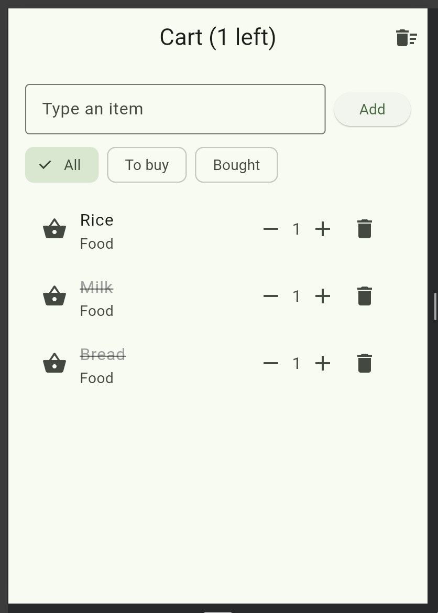
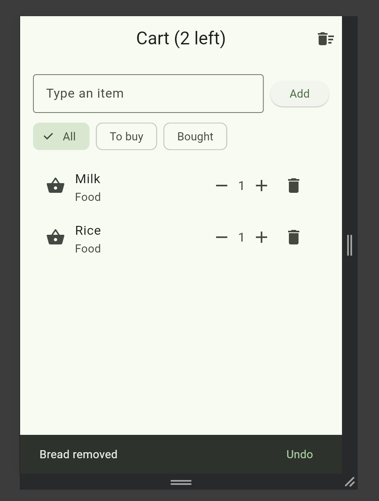
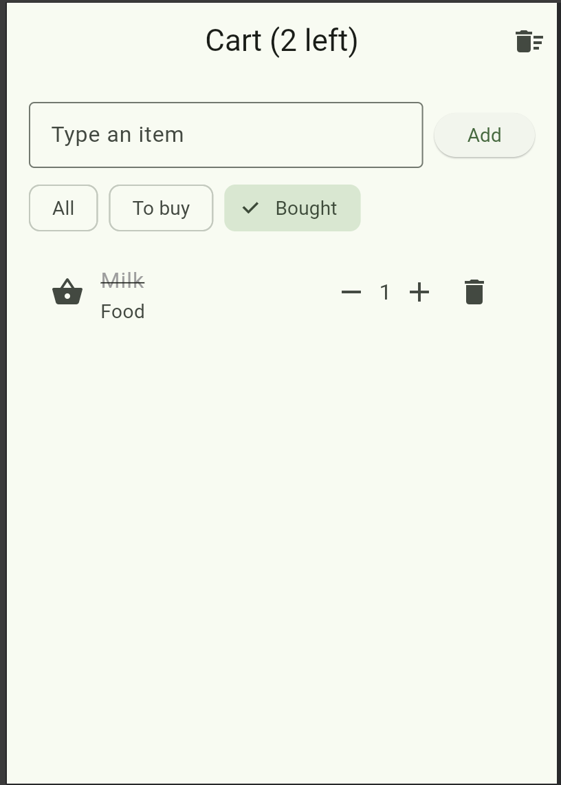
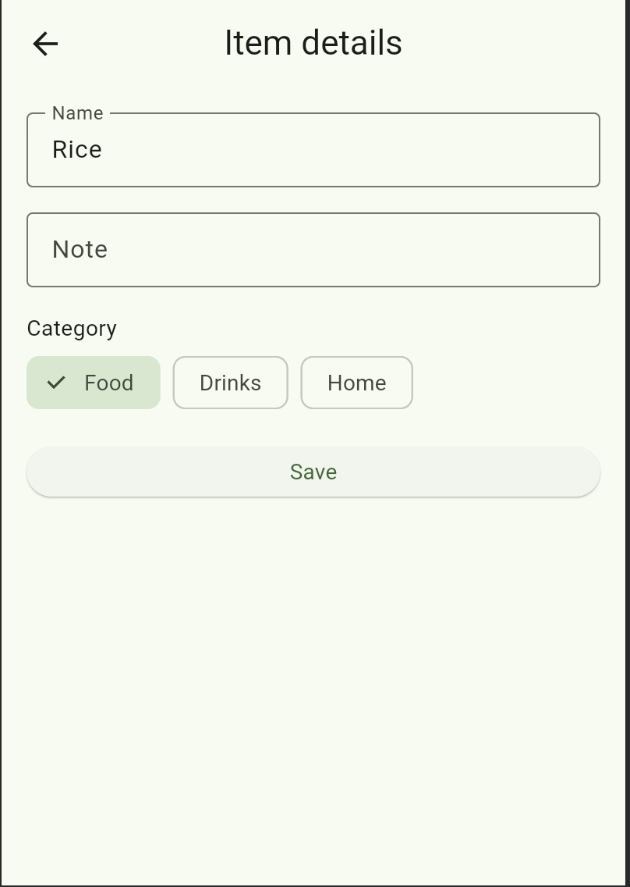

# Shopping List+

A Flutter shopping list app.

## Features
1. **Empty list message:** shows "Your list is empty" when there are no items.
2. **Quantities:** each item has − and + buttons; the quantity never goes below 1.
3. **No duplicates:** adding an item that already exists (any capitals or spaces) raises its quantity instead of adding a new row.
4. **Undo:** deleting an item shows an Undo button that puts it back in the same place.
5. **Filters:** All / To buy / Bought chips; bought items stay at the bottom of All.
6. **Item details:** long-press an item to edit its name, note and category (Food, Drinks, Home).

## Screenshots

## Think
1. With a filter on, `index` is a position in the `shown` list, not in `items`, so row 0 on screen is not item 0 in the list and the wrong item gets deleted. I fixed it by deleting the item itself with `items.remove(item)`.
2. The details screen must change the name after the item is created, and `final` only allows setting a value once. `final` is still a good choice for most fields because values that never change can't be changed by mistake.
3. Hot reload keeps the existing objects in memory, so the old items were created without `quantity`. A hot restart creates the items again with the new field.
4. Flutter only redraws a widget when `setState` is called. The item changed in memory, but the list didn't know until `setState` ran in `.then`. Flutter redraws when it is told the state changed, not whenever data changes.
